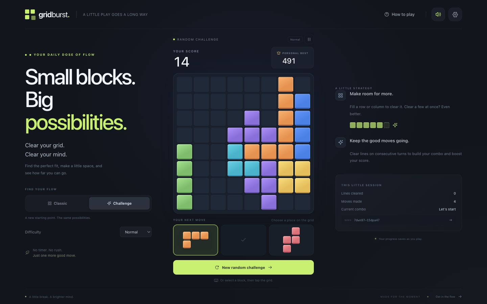
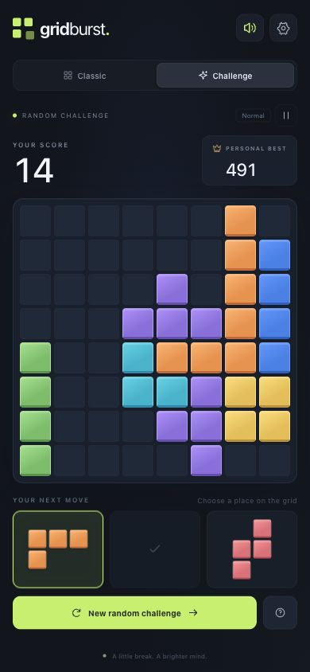

# Grid Burst

A complete, client-side block puzzle built with React 19, strict TypeScript and Vite. Make space, fill lines and keep the board moving. Grid Burst is an independent game inspired by classic block puzzle mechanics; its branding, CSS/SVG artwork, synthesized audio and scoring are original.

The app lives in `grid-burst/` inside the Block Blast repository. It needs no account, server, API key or database.

## Screenshots

Actual captures of the running application. The game starts with an empty Classic board.





See [`docs/verification.md`](docs/verification.md) for the executed checks and their limits.

## Features

- An immutable 8×8 engine with simultaneous row and column clearing, 46 validated shapes and seven glossy block colors.
- Classic and seeded Random Challenge modes, with Casual, Normal and Hard difficulty, plus the unrestricted **为所欲为** Free Play mode.
- Pointer-based mouse, trackpad and touch dragging, legal/illegal previews, and predicted line highlights.
- Click/tap selection and placement, plus keyboard placement controls.
- Placement points, line bonuses, consecutive-clear combos, best scores, particles and optional synthesized audio.
- Five Rescue hammer uses per Classic or Challenge run: preview and break the occupied cells blocking a selected piece, then place it in one confirmed move, including when no piece fits. Remaining uses survive a reload.
- Unlimited automatic overlap clearing, free piece rotation and free fresh trays in **为所欲为**, with no game over and a separate **FUN BEST**.
- Versioned, validated local saves that restore the board, remaining pieces and their rotations, score, combo, seed, RNG position, mode, difficulty and settings.
- Responsive portrait/landscape layouts, visible keyboard focus and reduced-motion support.
- Unit and randomized simulation tests, a strict production build and GitHub Pages workflows.

## Run locally

Use Node.js 22 LTS, or Node.js 20.19 or newer.

```sh
cd grid-burst
npm install
npm run dev
```

Open the local address Vite prints. For an existing checkout with the committed lockfile, use `npm ci` instead of `npm install`.

| Command | Purpose |
| --- | --- |
| `npm run dev` | Start the local development server. |
| `npm run lint` | Run ESLint, including the React hooks rules. |
| `npm run test` | Run the Vitest suite once. |
| `npm run test:watch` | Run Vitest in watch mode. |
| `npm run build` | Check strict TypeScript and build `dist/`. |
| `npm run preview` | Serve the production build locally. |

## Add to your iPhone Home Screen

1. Open [Grid Burst](https://user-dhw.github.io/Block-Blast/) in **Safari** on your iPhone.
2. Tap **Share**, then **Add to Home Screen**.
3. Keep the name **Grid Burst** and tap **Add**.

The website includes dedicated Home Screen icons and standalone launch metadata. iOS can cache icons for existing shortcuts; if an older shortcut keeps its previous icon, remove that Home Screen shortcut and add the website again from Safari.

## How to play

Classic and Random Challenge follow these rules:

1. Choose any of the three pieces. Drag it onto the board, or click/tap it and then choose its top-left target cell.
2. For ordinary placements, every square of a piece must land inside the board on an empty cell. Pieces keep their shown orientation.
3. Fill a complete row or column to clear it. All completed lines clear together, and their intersection cells clear only once.
4. Use all three pieces before receiving the next tray. An empty tray slot stays empty until then.
5. Keep placing pieces for as long as any remaining piece fits. One unusable piece does not end the game if another one still fits.
6. Choose **Rescue**, then select a tray piece and tap or drop it at a target position. The preview marks only the occupied cells within that piece's exact footprint. Choose **Break & place** to remove those blocking cells and place the selected piece in one move. Each blocked placement costs one of the run's five uses, regardless of how many blocking cells it removes. The end-of-run dialog also offers Rescue so you can select a piece when no ordinary move fits.

Cancelling a pending Rescue placement costs nothing, and a legal target with no blocking cells places normally without spending a use. A piece must fit entirely inside the board; out-of-bounds targets cannot be confirmed. A confirmed Rescue placement spends its tray piece, advances the turn and applies the usual placement points, line clears and combo rules. Destroying blocking cells awards no extra points. The tray refills after its last piece is placed, as with ordinary moves. A new Classic or Challenge run restores all five uses; refreshing keeps the remaining allowance.

There is no gravity or timer. Classic and Challenge pieces keep their shown orientation; player-controlled rotation is available only in Free Play. A move that does not clear a line resets the consecutive-clear combo. Invalid out-of-bounds drops leave the run unchanged. During touch dragging, the piece lifts above the finger to expose its target.

Classic begins empty. Random Challenge begins with clustered blocks produced by legal placements, occupying 13–22 of the 64 cells, approximately 20–35%. Every opening is checked against its tray so there is a legal first move. Click the seed chip to copy a replay link, or enter a seed or replay link in Settings and choose Replay seed. A plain seed uses the current mode and difficulty; a replay link carries both, including Free Play links with `mode=freeplay`. This starts the same opening again. Opening a link for the currently saved seed resumes that run so a browser refresh preserves progress. Future trays reproduce when the same placements and tray rerolls are made in the same order.

### 为所欲为 · Free Play

This mode starts with an empty board and uses the easy, small-piece-favoring Casual generator. It never reaches game over, and difficulty controls are hidden while it is active.

- **Place anywhere inside the board.** Drag or tap a piece directly over existing blocks to remove only its occupied footprint's blockers and place it immediately. Automatic Rescue is unlimited, shown as **∞**, and needs no confirmation. You can still choose **Rescue** manually for an optional blocker preview and **Break & place** confirmation.
- **Rotate freely.** **Rotate** turns the selected piece clockwise by 90°. If no piece is selected, it rotates the first available tray piece. Rotation is free and does not advance the turn.
- **Get new pieces.** **New pieces** replaces the tray as often as you like, for free, while preserving the board, score and turn count.
- **Keep your progress.** Rotations, the current tray after rerolls, the RNG position and the rest of the run are saved, so refreshing resumes the same state. Free Play keeps a separate **FUN BEST** and does not change Classic or Challenge personal bests.

Placements still consume a tray piece and use the usual scoring, line-clearing and combo rules. Rotation and fresh-tray tools are exclusive to this mode.

## Scoring

The scoring is configurable in [`src/game/scoring.ts`](src/game/scoring.ts). It is not a claim about another game's proprietary formula.

```text
placement = number of occupied cells placed
line base = 100 × lines + 50 × max(0, lines − 1)
combo = previous combo + 1 if at least one line clears; otherwise 0
multiplier = min(3, 1 + max(0, combo − 1) × 0.25)
move points = placement + round(line base × multiplier)
```

The first clear is 1×, the second consecutive clear is 1.25×, and the third is 1.5×. The ninth and later consecutive clears cap at 3×. Placement points do not receive the multiplier. For example, placing four cells and clearing two lines on the first clear earns `4 + 200 + 50 = 254` points.

## Randomness and difficulty

[`random.ts`](src/game/random.ts) uses Mulberry32 with persisted 32-bit state. String seeds are hashed with FNV-1a. New games normally get a fresh seed from browser cryptographic randomness, with a safe fallback when unavailable. This is a reproducible game generator, not a cryptographic system.

Every candidate tray makes three independent weighted selections. Duplicates are allowed. Base weights are visible next to every definition in [`shapes.ts`](src/game/shapes.ts).

| Difficulty | Weight adjustments | Tray safeguards |
| --- | --- | --- |
| Casual | Shapes with up to 3 cells ×2.16; shapes with 5 or more cells ×0.45. | Complete three-piece sequence checked. |
| Normal | Shapes with up to 3 cells ×1.2; shapes with 5 or more cells ×0.9. | Complete three-piece sequence checked. |
| Hard | Shapes with up to 2 cells ×0.66; 3-cell shapes ×1.2; shapes with 5 or more cells ×1.62. | One independently randomized tray; no complete-sequence guarantee. |

These weights gently ease all three difficulties: small shapes receive 20% more weight and large shapes 10% less than in the original release. Four-cell shapes are unchanged. Weights are relative rather than direct probabilities. Seeds use the current generator rules; existing saves keep their board, tray, scores and progress when upgrading.

For Casual and Normal, [`solver.ts`](src/game/solver.ts) searches piece orders and legal positions while simulating line clearing after every placement. It memoizes board/tray states and limits each candidate to 1,800 search nodes. Generation tries up to eight candidates. A search that runs out of budget is rejected conservatively even if an undiscovered solution may exist.

After retry exhaustion, the generator offers three single-cell pieces. A reachable non-terminal board has room for these as lines clear. In Classic and Challenge, an externally supplied terminal board is handled as game over; the generator never deletes occupied cells or changes scores to make a tray fit. Free Play always remains active because overlapping placements can clear their blockers. Hard openings still receive an additional legal-move check. The generator does not force losses or alter scores based on difficulty.

## Architecture

```text
grid-burst/
├── .github/workflows/deploy.yml  # Standalone repository Pages workflow
├── public/favicon.svg
├── src/
│   ├── App.tsx                  # Game composition and interface state
│   ├── components/              # Modal, icons and block rendering
│   ├── game/
│   │   ├── types.ts
│   │   ├── shapes.ts
│   │   ├── rotation.ts
│   │   ├── random.ts
│   │   ├── placement.ts
│   │   ├── clearing.ts
│   │   ├── scoring.ts
│   │   ├── solver.ts
│   │   ├── generator.ts
│   │   ├── initialBoard.ts
│   │   └── gameEngine.ts
│   ├── hooks/                   # Pointer input and optional Web Audio
│   ├── utils/                   # Coordinate conversion and validated saves
│   ├── styles/game.css
│   ├── tests/                   # Unit and randomized simulation tests
│   └── main.tsx
├── index.html
├── package.json
├── package-lock.json
├── tsconfig.json
└── vite.config.ts
```

Game rules remain in pure TypeScript. Ordinary placements, confirmed Rescue placements and Free Play's automatic overlap placements commit a single atomic transition and return no change for invalid, duplicate or stale placements. A Rescue preview does not change the board or spend an allowance. Rescue removes only the occupied cells in the selected piece's footprint before applying normal placement and line clearing. Transient visual effects do not mutate the board or replay after a reload. Pointer coordinates are calculated from the current board rectangle, padding and gaps rather than fixed screen positions.

Saves continue to use `grid-burst:v1:save`, with a version 2 save wrapper. Existing version 1 runs migrate without losing their board, tray, score, settings or best: an old three-use allowance gains two remaining charges once, while older saves without an allowance receive five. Saving the migrated run as version 2 prevents repeated grants. Version 2 validates the remaining standard-mode allowance from 0 to 5, rotated shape membership and mode rules. Nonzero piece rotations are accepted only for Free Play, which must use Casual difficulty and remain active even when no ordinary piece fits.

The separate `grid-burst:v1:best` record preserves the shared Classic/Challenge personal best across run resets; `grid-burst:v1:freeplay-best` preserves **FUN BEST** independently. Missing, malformed and incompatible data starts a fresh game. Unavailable storage does not prevent playing, but progress cannot survive a reload. The settings controls allow resetting saved progress without erasing either best-score record.

## Tests and verification

```sh
npm run lint
npm run test
npm run build
```

The engine suite covers empty boards, normalized and validated shapes, legal/overlapping/out-of-bounds moves, individual and simultaneous line clears, unique intersection counts, scoring, combo reset, tray lifetime, game-over decisions, seeded determinism, solvable trays, challenge openings and restart behavior. Storage tests cover valid restoration, malformed or incompatible saves and unavailable storage. Randomized simulations exercise multiple seeds and difficulty/mode combinations.

Production compilation verifies types and bundling. Real-browser interaction checks remain a separate validation step; a build alone does not establish touch-device compatibility.

Browser checks exercised desktop dragging, invalid overlaps, tray refill, reload, restart and a deterministic row clear worth 115 points. Layout checks at 1440×900, 390×844, 375×667 and 667×375 confirmed square boards, visible gameplay controls and no horizontal overflow. These results and their environment are recorded in [`docs/verification.md`](docs/verification.md).

## GitHub Pages deployment

The app is prepared for deployment. These files do not mean a public deployment has already occurred.

### Publish this app as its own repository

1. Create a GitHub repository and place the contents of `grid-burst/` at its root, including `.github/`, `package-lock.json` and the source files.
2. Push those files to the `main` branch.
3. Open **Settings → Pages → Build and deployment → Source** and select **GitHub Actions**.
4. Open **Actions → Deploy Grid Burst to GitHub Pages**. The workflow runs on pushes to `main`; use **Run workflow** for a manual run.
5. Confirm that dependency installation, lint, tests and production build pass, followed by artifact upload and Pages deployment.
6. Open the URL reported by the deployment environment.

The workflow uses Node.js 22, `npm ci` and the official GitHub Pages upload/deploy actions, with `contents: read`, `pages: write` and `id-token: write` permissions. No client-side secrets are required.

### Publish from this existing workspace repository

GitHub discovers workflows only in the repository's root `.github/workflows/` directory. Use the root workflow `.github/workflows/grid-burst-pages.yml`, which installs and builds from `grid-burst/` and uploads `grid-burst/dist/`. A workflow stored only inside `grid-burst/.github/` will not run for the parent repository.

Enable **Settings → Pages → GitHub Actions** for the parent repository, push to `main`, and check **Deploy Grid Burst to GitHub Pages** in Actions. Only one Pages site is deployed per repository, so this workflow publishes Grid Burst as that repository's site.

### Base paths and public URLs

The workflow uses the official `configure-pages` action's `base_path` output as `PAGES_BASE_PATH`, which takes precedence in `vite.config.ts`. Without that override, the config derives the base from `GITHUB_REPOSITORY`:

- A project repository publishes at `https://USERNAME.github.io/REPOSITORY/` and uses `/REPOSITORY/` as its asset base.
- A repository named `USERNAME.github.io` publishes at `https://USERNAME.github.io/`.
- Local builds default to `./`, which supports local preview and relative static hosting.

Set `PAGES_BASE_PATH` explicitly for a custom path or domain, for example:

```sh
PAGES_BASE_PATH=/my-puzzle/ npm run build
# Or build for the root of a custom domain:
PAGES_BASE_PATH=/ npm run build
```

No server routing configuration is needed because the game uses one page without application routes.

## Customization

- **Add a shape:** add a `shape(id, pattern, weight, color)` entry in `src/game/shapes.ts`. Use `#` for cells and `.` for gaps. Keep a unique ID, positive weight, orthogonally connected cells and a bounding box no larger than 5×5. Coordinates are normalized and definitions validated on load. Add each orientation explicitly and add or update relevant tests.
- **Change colors:** edit the seven color classes and their `--tile`, `--tile-light` and `--tile-shadow` values in `src/styles/game.css`. Keep the names aligned with `COLORS` in `src/game/types.ts` and shape definitions.
- **Change scoring:** edit `src/game/scoring.ts`, adjust its tests and the formula above. The interface consumes the engine's returned score rather than duplicating the rules.
- **Change shape frequency:** edit base weights in `src/game/shapes.ts` or difficulty factors in `src/game/generator.ts`. Keep the bounded solver and opening checks in place.
- **Add a mode:** extend the `GameMode` union, initialize its board in `createGame()`, expose a mode control in `App.tsx`, and extend the save validator and tests. Increment the storage schema version if old saves cannot be restored safely.

## Browser support and limitations

The app targets current Safari on iOS/macOS, Chrome on Android/desktop, Firefox and Chromium-based tablets. It uses Pointer Events, Web Audio, dynamic viewport units and modern CSS. Sound starts only after user interaction and can be muted; audio or vibration support is optional. No audio files, external fonts or runtime network requests are required.

Physical iPhone/Android touch and haptics have not been verified on actual hardware in this workspace. Browser-emulated pointer checks do not replace that testing. Old browsers without modern CSS/Pointer Events support are outside the target. Storage belongs to the current browser and origin; it is not cloud sync and is removed if the player clears website data. Hard mode intentionally does not guarantee that an entire newly generated tray has a valid sequence. The bounded Normal/Casual solver may use the safe fallback more often on a nearly full board.

There is no leaderboard, account system or undo. Classic and Challenge have fixed piece orientations; Free Play permits rotation and unlimited fresh trays. Seeds reproduce this version of the game's rules; changing shape weights or generator logic may change a seed's future results.
